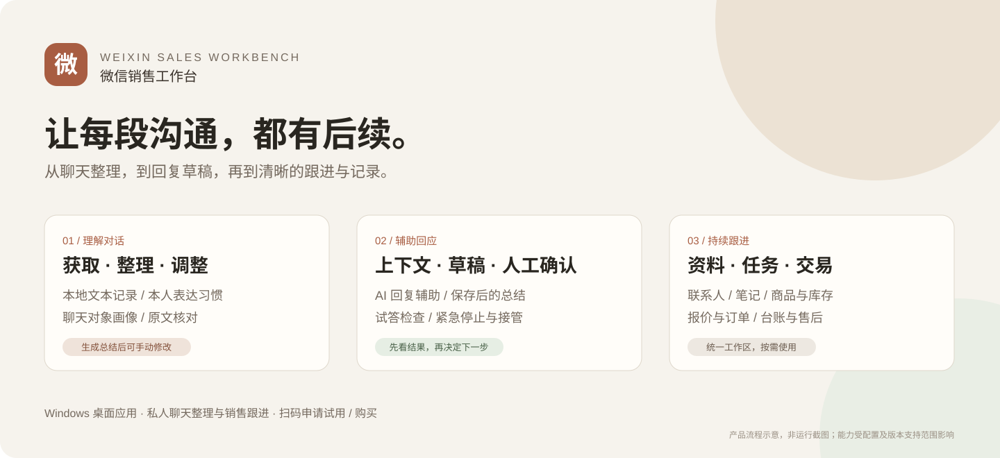

# 微信销售工作台

### 把聊天中的信息，变成可整理、可跟进的工作。

私人聊天记录整理 · 客户与联系人管理 · AI 回复草稿 · 销售业务协同

**Windows 桌面应用 · 商业软件 · 0.2.13**

[**打开商品主页**](https://beritwu.github.io/weixin-sales-workbench/) · [**下载安装**](https://github.com/Beritwu/weixin-sales-workbench/releases) · [**申请试用 / 购买**](#试用与购买) · [**完整功能**](docs/FEATURES.md) · [**安装指南**](docs/GETTING-STARTED.md)

---

微信里有对话、有约定，也有容易忘记的细节。微信销售工作台把会话辅助、聊天对象资料、跟进任务、商品、交易与笔记放到一个桌面工作区中。你可以先让 AI 整理和起草，再核对、修改并决定如何处理。

**适合个人聊天，也适合业务往来。** 整理自己的表达习惯与聊天对象资料，按需要使用客户、商品和交易功能。

> **安装后按三个步骤开始：连接微信 → 选择模型 → 获取聊天记录。** 0.2.13 已内置运行组件，首次使用页面带你完成配置。支持读取已保存的网关密钥、获取模型列表和即时试答。

## 从三个按钮开始

| 入口 | 可以做什么 |
| --- | --- |
| **获取微信聊天记录** | 获取当前电脑可读取的一对一文本记录，为后续整理提供原文依据。 |
| **生成人格** | 从本人的发言整理常用表达、语气和回应习惯，形成可编辑总结。 |
| **用户画像** | 选定聊天对象，整理已知情况、关系线索、近期关切、顾虑、决定与待确认事项。 |

生成后可查看所用原文、手动调整并保存。重新生成保留已有人工保存内容；试答可使用已保存的人格和画像。**通过可编辑总结和试答调整效果，无需模型微调。**

聊天学习读取电脑上已保存的**一对一文本记录**，每次总结使用所选范围最近 **160 条**文本。手机上的记录可先同步到电脑，再获取和整理。

## 一个工作台，覆盖日常工作

| 模块 | 功能范围 |
| --- | --- |
| **今日工作** | 汇总待处理事项、未回复、到期跟进、待付款、待发货和售后入口。 |
| **客户 / 聊天对象** | 管理资料、标签、关联会话、事实与记忆，整理互动信息。 |
| **会话与助手** | 查看会话记录和辅助资料，生成、修改 AI 回复草稿，保留人工处理入口。 |
| **跟进任务** | 记录待办与承诺，设置跟进时间，延期、交接或提交完成记录。 |
| **交易** | 报价、订单、收付款台账及售后管理，关联商品与客户信息。 |
| **商品** | 商品资料、价格、库存及导入管理，辅助报价和交易记录。 |
| **笔记** | 记录沟通要点、业务资料和后续安排，关联其他业务对象。 |
| **自动化** | 聊天学习、欢迎语、关键词、定时与转发规则配置，集中管理回复与任务安排。 |
| **批量任务** | 集中配置批量业务任务，查看逐项进度、结果、暂停和重试记录。 |
| **运行控制** | 查看连接、运行与异常状态，使用紧急停止及人工接管入口。 |
| **设置** | 首次使用引导、网关密钥读取、模型列表与实际试答、聊天读取初始化、账号、备份与业务参数。 |

微信贴边工具标签提供消息监听、消息管理和工具集，工作台侧边栏负责资料、任务和设置。两边保持独立窗口，操作时可以分别展开。

查看 [完整功能说明](docs/FEATURES.md) 和 [安装指南](docs/GETTING-STARTED.md)，按自己的使用场景开始。

## 使用流程

1. **下载安装包**：从 [Releases](https://github.com/Beritwu/weixin-sales-workbench/releases) 下载 Windows 安装包。
2. **联系开通**：加下方微信，说明想试用还是购买，并提供 Windows 和微信版本。
3. **输入登录密钥**：登录页只有一个密钥输入框，无需填写租户 ID、成员 ID。
4. **完成首次连接**：发现微信账号，读取或填写网关密钥并获取模型，再按需初始化本机聊天读取。
5. **先整理、再试答**：核对发言人、时间、计划和完成状态，保存调整后再检查回复草稿。

## 试用与购买

**扫码添加微信「阿西达卡」**，备注 **“工作台试用”** 或 **“工作台购买”**。

添加微信即可咨询功能演示、申请试用、购买授权和获取配置协助。价格与服务方案请直接沟通。

> 登录密钥由分发者提供，支持 **1 天体验 / 1 年使用**，从生成时开始计时。软件内可查看到期时间。

## 下载与更新

- **当前版本：0.2.13 首次连接与分发更新** — [直接下载 Windows 安装包（约 624 MB，含运行组件）](https://github.com/Beritwu/weixin-sales-workbench/releases/download/v0.2.13/WeixinSalesWorkbench-Setup-0.2.13.exe) · [版本说明](https://github.com/Beritwu/weixin-sales-workbench/releases/tag/v0.2.13) · [SHA-256 校验文件](https://github.com/Beritwu/weixin-sales-workbench/releases/download/v0.2.13/SHA256SUMS.txt)
- **安装包与版本说明**：[查看 Releases](https://github.com/Beritwu/weixin-sales-workbench/releases)
- **上手步骤与依赖**：[安装指南](docs/GETTING-STARTED.md)
- **常见问题**：[FAQ](docs/FAQ.md)
- **更新记录**：[CHANGELOG](CHANGELOG.md)
- **问题反馈**：[新建 Issue](https://github.com/Beritwu/weixin-sales-workbench/issues/new/choose)，或通过上方微信联系。

安装包附带 SHA-256 校验文件。更新时关闭工作台，选择原安装目录即可保留已有数据和配置。

## 数据与软件说明

- 聊天、业务记录和总结保存在本机工作区。云端 AI 使用你配置的模型服务处理本次选择的消息和上下文。
- 这个公开仓库提供产品展示、使用文档、问题反馈和安装包下载，开发源工程由产品方维护。
- 安装程序包含运行脚本、组件和资源。第三方组件的许可见发布文件中的说明。
- 本产品不是腾讯或微信官方产品，与其无官方隶属、合作或背书关系。

软件与本仓库内容的使用范围见 [使用说明](TERMS.md)。
